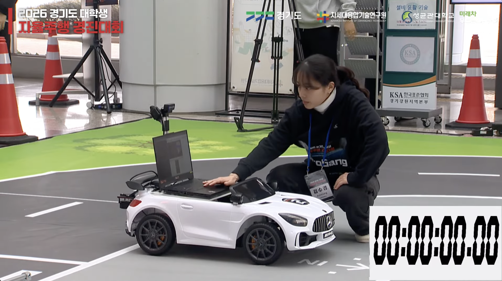
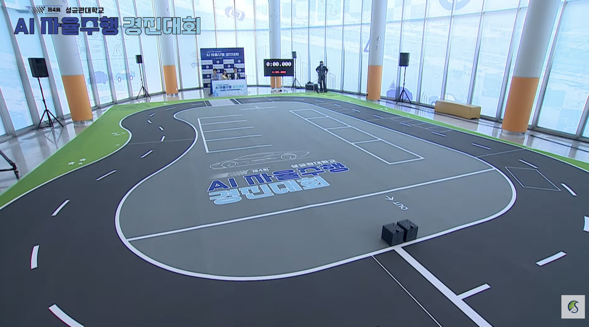

# ROS 2 Autonomous Vehicle

## Acknowledgments — 원본 플랫폼 및 소스코드 출처

본 프로젝트는 **성균관대학교 자동화연구실**에서 개발한 ROS 2 기반 자율주행 플랫폼 및 소스코드를 바탕으로 구현되었습니다. 제공받은 자율주행 시스템의 기능과 소스코드를 활용하였으며, 이를 기반으로 대회별 인지·판단·제어 및 주차 알고리즘, 시뮬레이션과 연구 프로젝트를 확장하였습니다.

- **Original Development:** [성균관대학교 자동화연구실](https://micro.skku.ac.kr/micro/index.do)
- **Original Source Code:** [SKKUAutoLab/ros2_autonomous_vehicle_book](https://github.com/SKKUAutoLab/ros2_autonomous_vehicle_book) — 『ROS 2 기반 자율주행 차량 설계 및 구현』 교재 실습 파일
- **Original Source Code:** [SKKUAutoLab/ros2_autonomous_vehicle_simulation](https://github.com/SKKUAutoLab/ros2_autonomous_vehicle_simulation)

> **공개 범위:** 소스코드·프로젝트 설명·연구 자료를 공유하며, 학습된 AI 모델 가중치(`.pt`, `.pth` 등)는 공개하지 않습니다. 모델이 필요한 경우 직접 학습하거나 정당한 접근 권한이 있는 원본에서 로컬로 준비해야 합니다. [실행 환경 안내](docs/reproduction.md) · [라이선스·크레딧](docs/license-and-credits.md)

**카메라·LiDAR 인지부터 주행·주차 제어, Gazebo 시뮬레이션까지**

ROS 2 기반 자율주행 시스템을 구현하고 대회, 전시, 연구로 확장한 기술 포트폴리오입니다.

**주요 대회·학회 수상: 대상 2회 · 금상 1회 · 동상 2회 · 연구 논문·원고 4편**

[프로젝트](#프로젝트) · [수상 자료](docs/awards/README.md) · [비교과 수상](docs/extracurricular/README.md) · [연구 논문](papers/README.md) · [데이터셋](#roboflow-데이터셋) · [기술 문서](#기술-문서)

*경기도 자율주행 경진대회 현장. [사진 출처: 대회 영상 7:11:52](https://www.youtube.com/watch?v=CVi-HjeEhWo&t=25912s)*

## 프로젝트

프로젝트를 선택하면 **개요 → 주요 구현 → 성과와 자료 → 코드 안내 → 실행 및 검증 범위** 순서로 살펴볼 수 있습니다.

| 프로젝트·연구 | 주요 내용 | 성과·자료 |
| --- | --- | --- |
| **[제4회 성균관대 AI 자율주행](projects/4th_skku_contest/README.md)** | 전·후방 인지, YOLO·TensorRT 노드, 상태 기반 주차, 실차·Gazebo 실행 구성 | **SW부문 대상** · 2026.07.30 · [상장](docs/awards/skku-4th.pdf) |
| **[경기도 대학생 자율주행](projects/gyeonggido_contest/README.md)** | 카메라·LiDAR 기반 주차 공간 인지, 상태 전이와 차량 제어 | **대상** · 2026.02.11 · [상장](docs/awards/gyeonggido.pdf) |
| **[제3회 성균관대 자율주행](projects/3rd_skku_contest/README.md)** | YOLO·BEV 차선 인식, LiDAR 주차 FSM, ROS 2·Arduino 연동 | **SW부문 금상** · 2025.07.18 · [상장](docs/awards/skku-3rd.pdf) |
| **[전국 대학생 AI 자율주행 경진대회](docs/awards/national-ai-2026.pdf)** | 2026 전국 대학생 AI 자율주행 경진대회 참가·수상 | **동상** · 2026.08.10 · [상장](docs/awards/national-ai-2026.pdf) |
| **[한국정보처리학회 ASK 2026](docs/awards/kips-bronze.pdf)** | ROS2 자율주행 프레임워크에서의 수직 주차 성능 향상 | **논문경진대회 동상** · 2026.05.21 · [상장](docs/awards/kips-bronze.pdf) |
| **[Gazebo 자율주행 시뮬레이션](projects/autonomous_simulation/README.md)** | 차량·센서 시뮬레이션, 주행 시나리오, 방문자 체험 GUI | [Expo 전시 기록](projects/autonomous_simulation/exhibition/README.md) · [알고리즘 테스트 안내](projects/autonomous_simulation/testing/README.md) |

수상 날짜는 상장 기재일입니다. [상장 미리보기 및 원본 PDF](docs/awards/README.md)에서 확인할 수 있습니다.

## 실제 대회장과 제작한 가상환경

| 실제 대회장 — 제4회 성균관대 | 제작한 가상환경 |
| --- | --- |
|  | 사진 추가 예정 |

[실제 대회장 사진 출처: 대회 영상 4:06:05](https://www.youtube.com/watch?v=2yOSjMr1Qcw&t=14765s) · [Expo 구현 기록](projects/autonomous_simulation/exhibition/README.md)

## 비교과 수상

자율주행 심화 SW **은상**, 자율주행 AI SW 설계 **대상**, Zonal Architecture 시스템 설계 **동상**을 [비교과 수상 모음](docs/extracurricular/README.md)에 정리했습니다.

## 연구 논문

| 연구 | 핵심 내용 | 분류 |
| --- | --- | --- |
| [모듈형 ROS 2 자율주행 프레임워크](papers/ksae25/README.md) | 인지·판단·제어 모듈화와 실차 적용 | KSAE 2025 |
| [다중 센서 기반 수직주차](papers/ask26/README.md) | 전·후방 카메라와 LiDAR를 결합한 상태 기반 주차 | ASK 2026 |
| [RF-DETR 모델 경량화](papers/ksae26/rf-detr-compression.md) | 26개 후보의 정확도·지연·엔진 크기 비교 | KSAE 2026 발표 확정 논문 |
| [E2E 차선 유지 시뮬레이션 사전학습](papers/ksae26/simulation-pretraining.md) | Gazebo 사전학습과 실차 파인튜닝 비교 | KSAE 2026 발표 확정 논문 |

[논문 요약 및 PDF 모아보기](papers/README.md) · KSAE 2026 학술대회에서 논문 2편의 발표가 확정되었습니다.

## Roboflow 데이터셋

자율주행 인지 모델 학습을 위해 직접 수집하고 라벨링한 데이터셋입니다.

| 프로젝트 | 공개 데이터셋 |
| --- | --- |
| 전방 주차 | [parking_front](https://universe.roboflow.com/hmobility-fvu9x/parking_front) |
| 일반·미션 주행 | [general/mission](https://universe.roboflow.com/hmobility-fvu9x/general-mission-b1s9c) |
| 후방 주차 | [parking_rear](https://universe.roboflow.com/hmobility-fvu9x/parking_rear) |
| 횡단보도 | [crosswalk](https://universe.roboflow.com/hmobility-fvu9x/crosswalk-ri5mp) |

## 기술 문서

| 살펴볼 내용 | 안내 |
| --- | --- |
| 프로젝트별 기술과 차이 | [프로젝트 비교](docs/project-comparison.md) |
| 센서에서 차량 제어까지의 흐름 | [시스템 구조](docs/architecture.md) |
| 설치·모델 복구·실행 명령 | [실행 환경 안내](docs/reproduction.md) |

**개발 환경:** ROS 2 Humble · Python · C++ · Gazebo Classic · Arduino

**인지·제어:** Camera · 2D LiDAR · YOLO · RF-DETR · TensorRT · BEV · FSM

## 활용 및 참고

이 프로젝트를 활용하거나 참고하셨다면, GitHub Fork를 통해 사용 흔적을 남겨주세요. 파생 프로젝트의 README에 [원본 저장소](https://github.com/ksk192830/ROS2_AutonomousVehicle) 링크를 표기해 주시면 감사하겠습니다.
