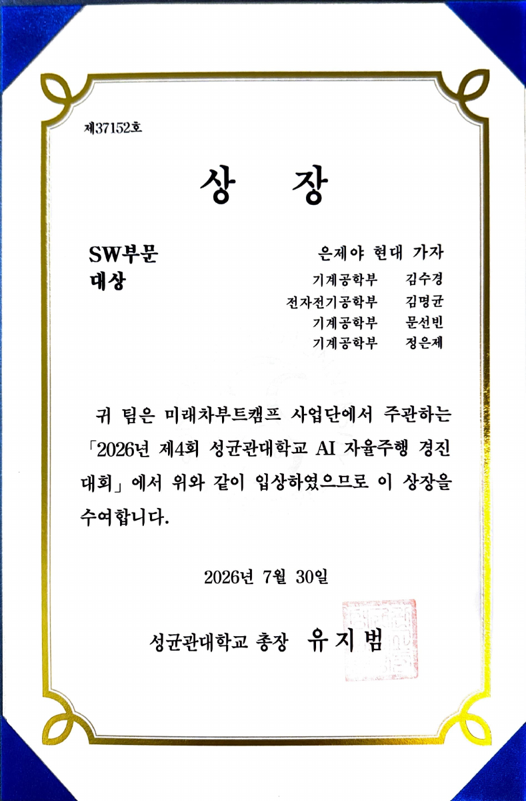
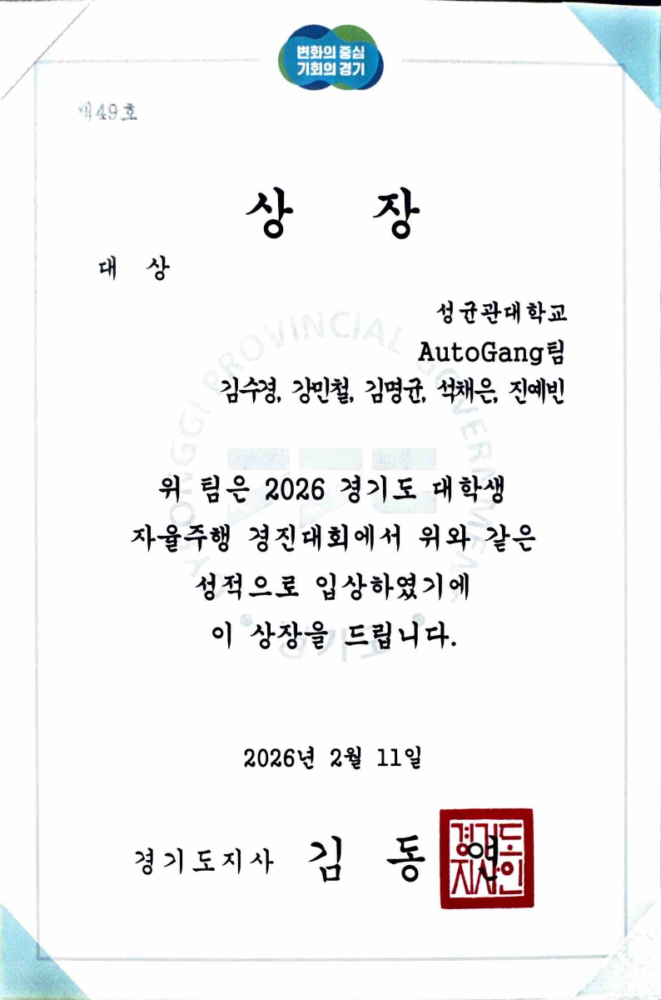
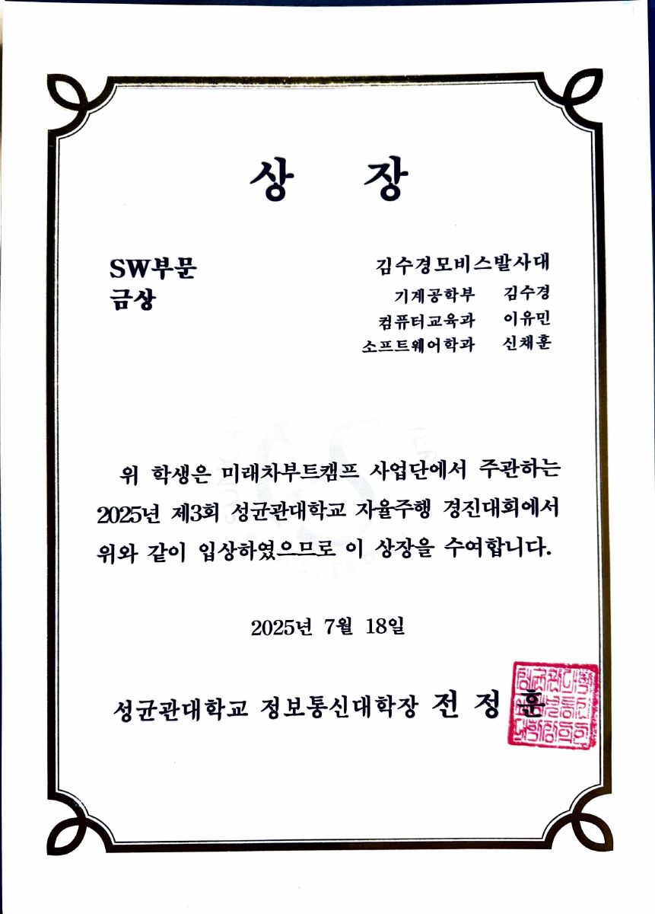
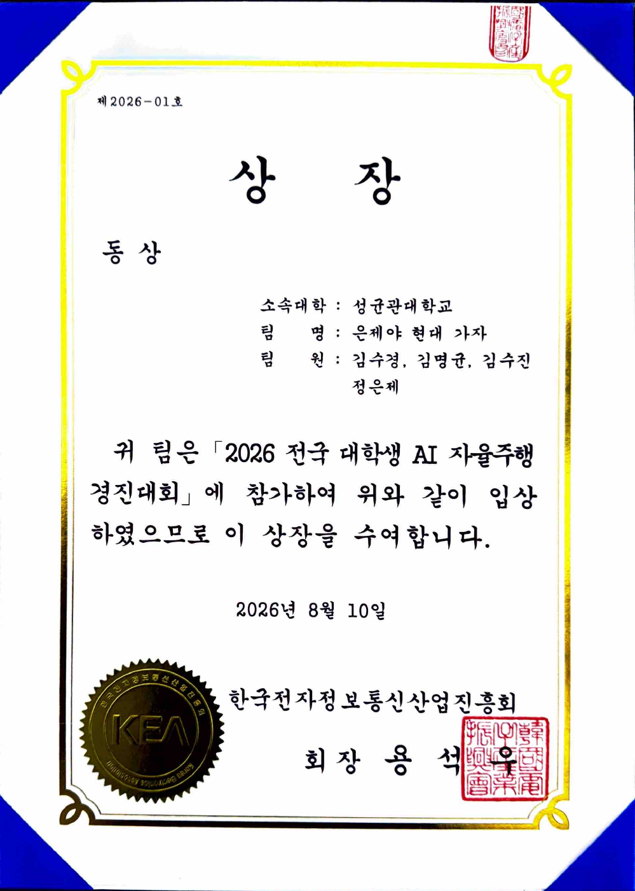
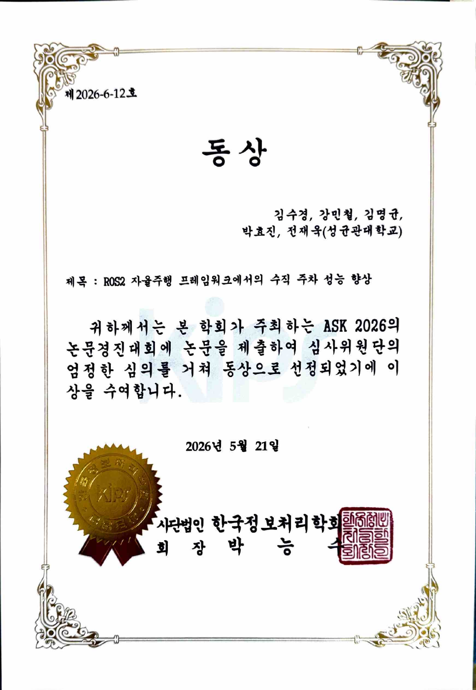

# 수상 자료

대회·학회별 상장 원본 PDF와 미리보기입니다. 날짜는 상장에 기재된 수여일이며, 원본 PDF는 내용 수정 없이 보존했습니다.

| 대회·학회 | 수상 | 수여일 | 원본 |
| --- | --- | --- | --- |
| 2026 전국 대학생 AI 자율주행 경진대회 | **동상** | 2026.08.10 | [PDF](national-ai-2026.pdf) |
| 2026년 제4회 성균관대학교 AI 자율주행 경진대회 | **SW부문 대상** | 2026.07.30 | [PDF](skku-4th.pdf) |
| 한국정보처리학회 ASK 2026 논문경진대회 | **동상** | 2026.05.21 | [PDF](kips-bronze.pdf) |
| 2026 경기도 대학생 자율주행 경진대회 | **대상** | 2026.02.11 | [PDF](gyeonggido.pdf) |
| 2025년 제3회 성균관대학교 자율주행 경진대회 | **SW부문 금상** | 2025.07.18 | [PDF](skku-3rd.pdf) |

## 제4회 성균관대학교 AI 자율주행 경진대회

[프로젝트 보기](../../projects/4th_skku_contest/README.md)

## 경기도 대학생 자율주행 경진대회

[프로젝트 보기](../../projects/gyeonggido_contest/README.md)

## 제3회 성균관대학교 자율주행 경진대회

[프로젝트 보기](../../projects/3rd_skku_contest/README.md) · [포트폴리오 홈](../../README.md)

## 2026 전국 대학생 AI 자율주행 경진대회

## 한국정보처리학회 ASK 2026 논문경진대회

**수상 논문:** ROS2 자율주행 프레임워크에서의 수직 주차 성능 향상

[포트폴리오 홈](../../README.md)

교내 경진대회·교육과정 상장은 [비교과 수상 모음](../extracurricular/README.md)에서 확인할 수 있습니다.
