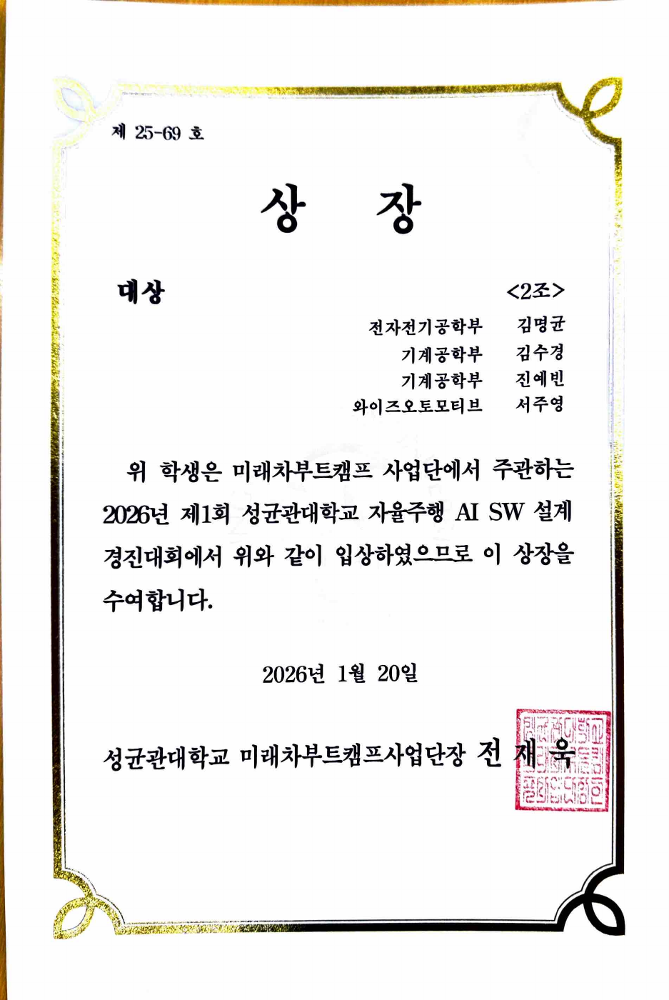
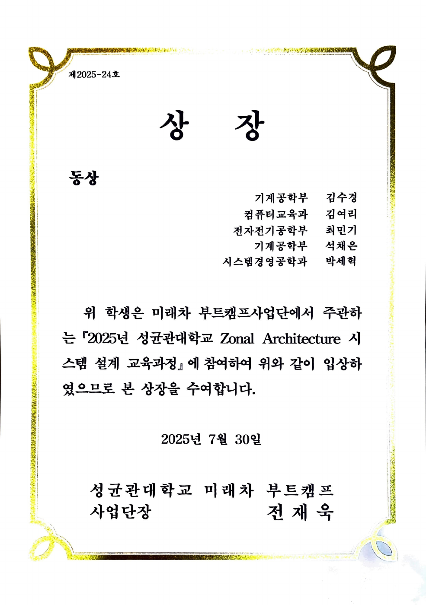
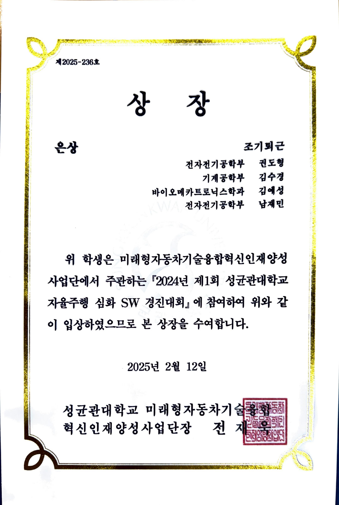

# 비교과 수상

교내 경진대회와 교육과정에서 받은 상장을 모았습니다. 날짜는 상장 기재 수여일이며, 원본 PDF는 수정 없이 보존했습니다.

| 활동 | 수상 | 수여일 | 원본 |
| --- | --- | --- | --- |
| 2026년 제1회 성균관대학교 자율주행 AI SW 설계 경진대회 | **대상** | 2026.01.20 | [PDF](ai-sw-design.pdf) |
| 2025년 성균관대학교 Zonal Architecture 시스템 설계 교육과정 | **동상** | 2025.07.30 | [PDF](zonal-architecture.pdf) |
| 2024년 제1회 성균관대학교 자율주행 심화 SW 경진대회 | **은상** | 2025.02.12 | [PDF](autonomous-driving-sw.pdf) |

## 2026년 제1회 성균관대학교 자율주행 AI SW 설계 경진대회

## 2025년 성균관대학교 Zonal Architecture 시스템 설계 교육과정

## 2024년 제1회 성균관대학교 자율주행 심화 SW 경진대회

[주요 대회·학회 수상](../awards/README.md) · [포트폴리오 홈](../../README.md)
