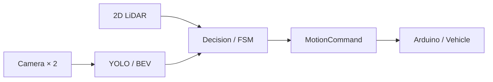

# 제3회 성균관대학교 자율주행 경진대회

**SW부문 금상 · 2025.07.18** · [상장 PDF](../../docs/awards/skku-3rd.pdf)

## 프로젝트 개요

카메라·LiDAR의 인지 결과를 ROS 2 토픽으로 연결하고, 주행 판단과 Arduino 차량 제어를 분리한 자율주행 시스템입니다. 기록주행, 장애물·신호등 미션, 수직주차를 각각의 실행 구성으로 관리합니다.

**기술:** ROS 2 Humble · YOLO Segmentation · BEV · RPLIDAR A1 · FSM · Arduino

## 주요 구현

| 과제 | 구현 |
| --- | --- |
| 차선과 주행 상황 인지 | 듀얼 카메라 영상, YOLO 세그멘테이션, BEV 기반 차선 인식 |
| 미션별 행동 선택 | 일반·미션·주차 판단 노드와 사용자 정의 메시지 |
| 수직주차 | LiDAR 기반 탐색·후진·보정·탈출의 8단계 FSM |
| 차량 구동 | `MotionCommand`를 Arduino 모터·조향 명령으로 전달 |



## 성과와 자료

- **제3회 성균관대학교 자율주행 경진대회 SW부문 금상.** [상장 미리보기](../../docs/awards/README.md)
- 관련 KSAE 2025 논문에는 공식 기록주행 **1분 32.67초**, 미션주행 **감점 없음**이 기록되어 있습니다.
- 공식 대회의 수직주차는 초기 조건에 민감해 실패했으며, 이후 주차 알고리즘 개선의 배경이 되었습니다. [연구 요약·PDF](../../papers/ksae25/README.md)

## 코드 안내

| 살펴볼 내용 | 코드 |
| --- | --- |
| 카메라·차선·객체 인지 | [camera_pkg](src/camera_pkg/) |
| 일반·미션·주차 판단 | [decision_making_pkg](src/decision_making_pkg/) |
| LiDAR 주차 FSM | [rear_parking_fsm.py](src/lidar_pkg/lidar_pkg/rear_parking_fsm.py) |
| 차량 제어·메시지 | [control_pkg](src/control_pkg/) · [interfaces_pkg](src/interfaces_pkg/) |
| 장치 설정·펌웨어 | [hardware.yaml](src/camera_pkg/config/hardware.yaml) · [driving.ino](driving/driving.ino) |

## 실행 및 검증 범위

Ubuntu 22.04 / ROS 2 Humble을 기준으로 한 독립 워크스페이스입니다. 실행 모델 `final.pt`는 공개하지 않으며 권한 있는 사용자가 로컬에 별도로 준비해야 합니다. 카메라·LiDAR 설정은 `hardware.yaml`, Arduino 포트는 제어 노드 파라미터로 지정합니다.

<details>
<summary>실행 명령 참고</summary>

Ultralytics/YOLO와 PyYAML을 별도로 준비합니다. CPU 사용 시 `inference_device: cpu`로 설정합니다.

```bash
# 저장소 루트에서
# 먼저: bash tools/add_3rd_model.sh /path/to/final.pt
cd projects/3rd_skku_contest
colcon build --symlink-install
source install/setup.bash
ros2 launch camera_pkg final.py
# 미션: final_mission.py / 주차: final_parking.py
```

</details>

통합 저장소에서 이 프로젝트의 ROS 빌드·실제 주행은 재검증하지 않았습니다. 위 대회 성과는 당시의 결과입니다. [검증 범위](../../docs/validation.md)

## 관련 문서

[모듈형 ROS 2 연구](../../papers/ksae25/README.md) · [프로젝트 비교](../../docs/project-comparison.md) · [이관 기록](../../docs/migration-notes.md) · [포트폴리오 홈](../../README.md)
